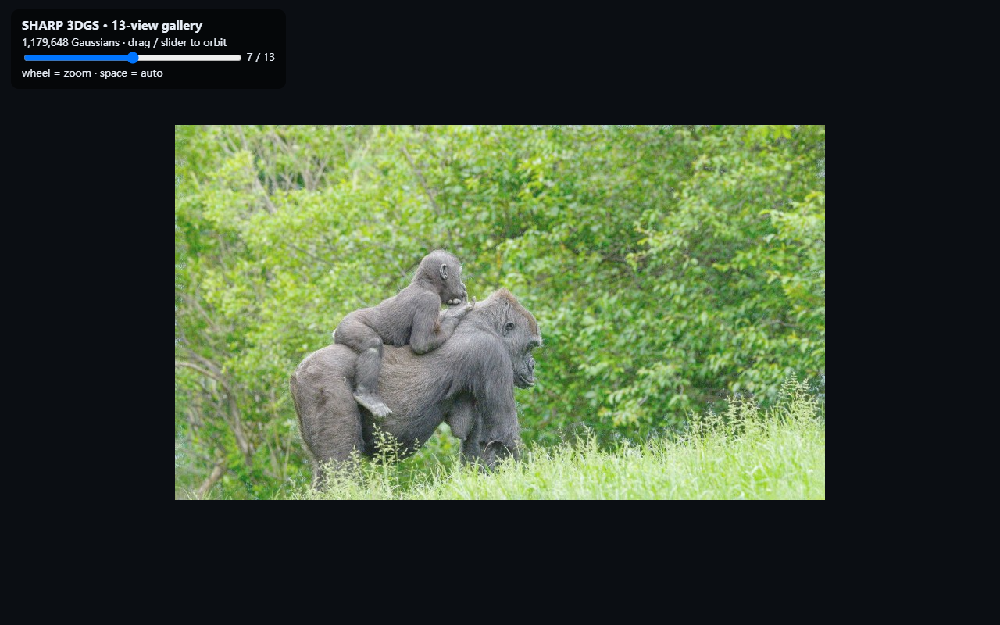

# Vulkan World Models

Vulkan / wgpu experiments for running world models and 3D Gaussian Splatting on an **AMD Radeon RX 6900 XT** under Windows, without CUDA.

This repository collects:

- **LingBot-World 1.3B causal-fast** inference ported to Rust + wgpu/Vulkan
- **3D Gaussian Splatting** renderer and browser viewers
- **VkSplat** integration: Vulkan tile-based 3DGS training with backward, SH, and densification
- 3D point-cloud / fly-through experiments built from generated frames

## Results

### LingBot-World

| Item | Result |
| --- | --- |
| Model | LingBot-World 2.0 1.3B causal-fast |
| Layers | 30 |
| Dim / FFN | 1536 / 8960 |
| Sampler | FlowUniPC, 4 steps |
| VAE | Wan2.1 VAE, z16 |
| Text encoder | UMT5-XXL, CPU |
| Backend | Rust + wgpu / Vulkan |
| Hardware | AMD RX 6900 XT 16GB |

Final single-frame inference:


### Gaussian Splatting viewer

Real 3DGS billboard render of the SHARP rainforest scene:


13-view Chrome gallery:



### VkSplat training

Vulkan tile rasterizer + differentiable backward, trained 10k steps on a 14-view synthetic COLMAP scene:

| Metric | Value |
| --- | --- |
| Splats | 319,073 |
| Train PSNR | 38.21 dB |
| Validation PSNR | 20.65 dB |
| Time | 49.7 s |
| VRAM | ~0.33 GiB |

See [VKSPLAT_RESULTS.md](gaussian-splatting/VKSPLAT_RESULTS.md).

## Layout

```text
lingbot/
  FULL_FORWARD.md, PORTING.md, NUMERICS.md, ...
  wgpu-*/                  Rust wgpu compute kernels for DiT / VAE / T5
  glsl/                    shaders
  *.py                     CPU driver / reference scripts

gaussian-splatting/
  vulkan-rs/               Rust wgpu Gaussian-splat renderer + viewers
  VKSPLAT.md               Vulkan training integration notes
  VKSPLAT_RESULTS.md       10k training evidence
```

## Build

### 3DGS renderer

```powershell
cd gaussian-splatting/vulkan-rs
cargo build --release
```

Render a compact 14-float 3DGS PLY:

```powershell
.\target\release\vulkan-splat.exe photo.ply 0.0 out.png 0.10
```

### LingBot wgpu kernels

Each `lingbot/wgpu-*` directory is a standalone Rust crate. See its `README.md` and `src/`.

Real weights (18GB) are **not** included; see [lingbot/WEIGHTS.md](lingbot/WEIGHTS.md).

## Data / weights

Excluded from Git:

- LingBot 1.3B / 14B weights
- Wan2.1 VAE and UMT5-XXL weights
- 75MB trained PLY and large HTML viewers
- SHARP model weights

Model licenses remain with their authors. LingBot weights are
**CC BY-NC-SA 4.0** (non-commercial).

## Licenses and credits

- LingBot-World: upstream code/weights **CC BY-NC-SA 4.0** (non-commercial).
- VkSplat: external project, Apache-2.0 —
  https://github.com/harry7557558/vksplat
- SHARP / ml-sharp: Apple Machine Learning Research Model License.
- 3D Gaussian Splatting: INRIA / MPII, non-commercial research license.

Because this repository contains LingBot-derived material, the repository as a
whole is distributed under **CC BY-NC-SA 4.0**. See [LICENSE](LICENSE).

## Status / limitations

- LingBot is a video world model, not a native mesh/depth generator.
- The single-frame 4-step output works; multi-frame chunks still collapse.
- 3DGS viewer supports full 1.18M centers; the full HTML is 81MB and is not committed.
- VkSplat training was validated on a small synthetic multi-view set, not a
  Mip-NeRF 360 benchmark.
