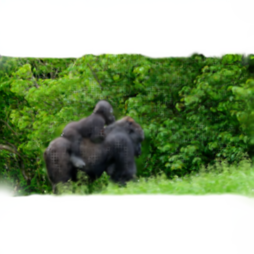
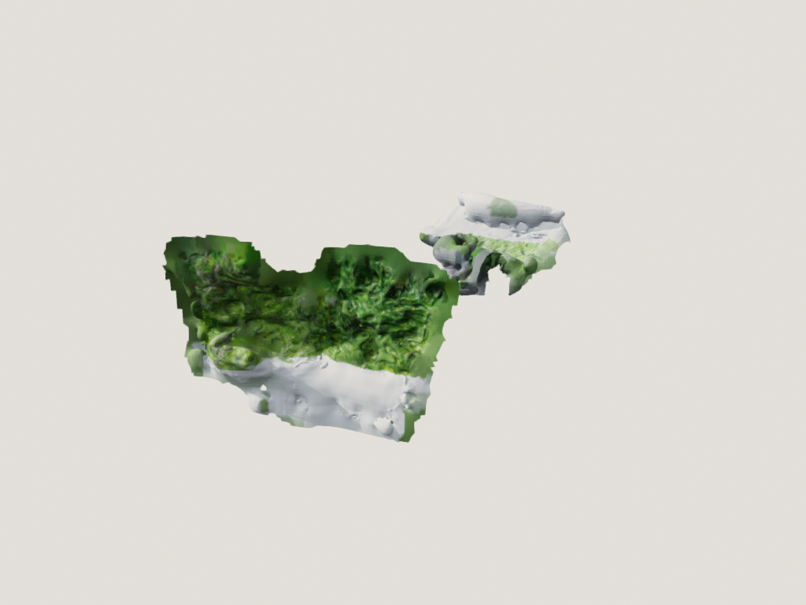

# Vulkan World Models / Vulkan 世界模型

**中文（主）** | [English](#english)

在 **AMD Radeon RX 6900 XT + Windows** 上，用 **Rust / wgpu / Vulkan** 跑世界模型和 3D Gaussian Splatting，不依赖 CUDA。

> 本项目是工程移植与验证仓库，不是 LingBot / VkSplat 官方仓库。

Hugging Face 模型页：

- HunyuanWorld：<https://huggingface.co/kylinfires/hunyuanworld-vulkan>
- LingBot：<https://huggingface.co/kylinfires/lingbot-world-vulkan>
- 3DGS / VkSplat：<https://huggingface.co/kylinfires/gaussian-splatting-vulkan>

---

# 中文

## 项目简介

本仓库包含四条工作线：

1. **LingBot-World 1.3B Vulkan kernel port（部分完成）**
   - Rust + wgpu/Vulkan
   - 30 层 DiT、UMT5-XXL、Wan2.1 VAE 的逐算子/小尺度 block 验证
   - ✅ RMSNorm/GEMM/RoPE/attention/KV cache/conv3d/VAE 组件
   - ❌ 完整 1.3B DiT 前向、完整 VAE、T5 Vulkan、4-step 视频生成
   - 详见 [lingbot/README.md](lingbot/README.md)

2. **3D Gaussian Splatting Vulkan 渲染器**
   - Rust + wgpu
   - 解析 14-float 紧凑 3DGS PLY
   - 3D 协方差 → EWA 2D 投影 → billboard splat
   - 直接输出 PNG
   - 浏览器 gallery / WebGL viewer

3. **VkSplat Vulkan 训练集成**
   - Vulkan compute tile rasterizer
   - per-tile sort
   - 可微 backward
   - SH 优化与 densification
   - 在 AMD RX 6900 XT 上实际训练 10k steps

4. **HunyuanWorld-Mirror Vulkan 推理移植**
   - 单图 / 多图 / 视频 → 深度、法线、相机、点云、3DGS
   - 72 个 transformer block（24 DINOv2 + 24 frame + 24 global）
   - Camera head + 4 个 DPT head + 3DGS 参数化
   - TSDF / Poisson mesh、内置 3DGS 渲染与 turntable
   - 不依赖 CUDA / PyTorch / gsplat

## 结果

### LingBot Vulkan kernel 验证（未完成完整推理）

| 项目 | 结果 |
| --- | --- |
| 模型 | LingBot-World 2.0 1.3B causal-fast |
| 状态 | **PARTIAL / BLOCKED** |
| 已验证 | kernels、单 block、小尺度 VAE、30 层链式运行 |
| 未完成 | 完整 1.3B DiT、完整 VAE、T5 Vulkan、4-step 视频 |
| 层数 | 30 |
| dim / FFN | 1536 / 8960 |
| 文本编码 | UMT5-XXL, CPU |
| 后端 | Rust + wgpu / Vulkan |
| 硬件 | AMD RX 6900 XT 16GB |


### HunyuanWorld-Mirror Vulkan 推理

单图 / 多图 / 视频输入，Rust + wgpu/Vulkan 全 GPU 前向：

| 项目 | 结果 |
| --- | --- |
| 模型 | HunyuanWorld-Mirror, 1.26B params, 5.05GB f32 |
| 单图 518×518 | 11.1 s |
| 2 视图 | 21.5 s |
| 4 视图 | 49.1 s |
| 输出 | depth / normals / camera / points / 3DGS / mesh / render |
| 数值验证 | camera 3e-7, depth 5.9e-5（2 视图） |






详见 [hunyuanworld/PORTING.md](hunyuanworld/PORTING.md)。

### 3DGS Vulkan 渲染


13 视角 Chrome gallery：


### VkSplat 训练

14 视角合成 COLMAP 场景，10,000 steps：

| 指标 | 数值 |
| --- | --- |
| Splats | 319,073 |
| Train PSNR | 38.21 dB |
| Validation PSNR | 20.65 dB |
| 时间 | 49.7 s |
| VRAM | ~0.33 GiB |

Vulkan pass 实际执行：

```text
ComputeTileRanges                    10,000
SortRTS                              10,080
RasterizeForward                     10,000
RasterizeBackward                    10,000
FusedProjectionBackwardOptimizerStep 10,000
```

## 目录结构

```text
lingbot/
  FULL_FORWARD.md, PORTING.md, NUMERICS.md, ...
  wgpu-*/                  DiT / VAE / T5 的 Rust wgpu kernels
  glsl/                    shaders
  *.py                     CPU 驱动与参考脚本
  first_frame_fix_final.png

gaussian-splatting/
  vulkan-rs/               Rust wgpu 3DGS 渲染器 + 浏览器 viewer
  VKSPLAT.md               VkSplat Vulkan 训练集成说明
  VKSPLAT_RESULTS.md       10k 训练结果

hunyuanworld/
  src/                     HunyuanWorld-Mirror Rust/wgpu 推理引擎
  scripts/                 权重下载 / 视频抽帧 / mesh / mesh render
  docs/                    3DGS / turntable / TSDF mesh 预览
  PORTING.md               架构、算子、验证、性能
```

## 快速开始

### HunyuanWorld-Mirror

```powershell
cd hunyuanworld
py -3 -m pip install -r requirements.txt
py -3 scripts/download_weights.py
cargo build --release --bin hwm-vk

# 单图 + mesh + 3DGS render + turntable
.\target\release\hwm-vk.exe --image photo.jpg --mesh poisson --mesh-render --turntable 8 --out out

# 多图
.\target\release\hwm-vk.exe --images frames --max-views 8 --out out

# 视频
.\target\release\hwm-vk.exe --video clip.mp4 --fps 1 --max-views 8 --out out
```

### 3DGS 渲染器

```powershell
cd gaussian-splatting/vulkan-rs
cargo build --release

.\target\release\vulkan-splat.exe photo.ply 0.0 out.png 0.10
```

`argv[2]` 是 yaw，`argv[3]` 是输出 PNG，`argv[4]` 是最小 splat sigma。

### LingBot wgpu kernels

每个 `lingbot/wgpu-*` 目录都是独立的 Rust crate，见各自的 `README.md` / `src/`。

```powershell
cd lingbot/wgpu/wgpu-dit-block
cargo build --release
```

LingBot 目前只验证到 kernel/小尺度 block；完整推理还需要权重、CPU driver 和显存流式，权重不包含在本仓库。

## 权重

**本仓库不包含模型权重。** 权重总量约 17.5GB（DiT 6.8GB + VAE 0.5GB + T5 10.6GB），另有 f32 分块约 10GB。

上游来源：

| 组件 | 上游 |
| --- | --- |
| 1.3B transformer | `Robbyant/lingbot-world-v2-1.3b-causal-fast` |
| VAE | `Robbyant/lingbot-world-v2-14b-causal-fast` 下的 `Wan2.1_VAE.pth` |
| T5 | 同一 14B repo 下的 `models_t5_umt5-xxl-enc-bf16.pth` |
| HunyuanWorld-Mirror | `tencent/HunyuanWorld-Mirror`，5.05GB f32 |

HunyuanWorld 权重受 **Tencent HunyuanWorld-Mirror Community License** 约束（不含 EU/UK/韩国），本仓库不包含权重。

如果要做“下载即跑”的镜像，建议只上传 **1.3B DiT + VAE（约 7.3GB）** 到 HuggingFace model repo；T5 可复用上游 `google/umt5-xxl`。

## 浏览器查看

- 13 视角 gallery：`gaussian-splatting/vulkan-rs/gaussian_gallery.html`
- 交互式中心点云：`gaussian-splatting/vulkan-rs/gaussian_viewer.html`
- 全量 1.18M WebGL splat viewer：`gaussian-splatting/vulkan-rs/gaussian_splat_full.html`
  - 约 82MB，未提交到 Git
- 在线 gallery：<https://huggingface.co/spaces/kylinfires/vulkan-world-models>

## 许可证与来源

- LingBot-World 上游代码/权重：**CC BY-NC-SA 4.0**
- VkSplat：Apache-2.0，<https://github.com/harry7557558/vksplat>
- SHARP / ml-sharp：Apple Machine Learning Research Model License
- 3D Gaussian Splatting：INRIA / MPII 非商业研究许可
- HunyuanWorld-Mirror：Tencent HunyuanWorld-Mirror Community License；`hunyuanworld/` 下的 Rust/WGSL 原创代码为 Apache-2.0

由于包含 LingBot 衍生材料，**本仓库整体按 CC BY-NC-SA 4.0 发布，禁止商业使用**。第三方组件仍遵循各自许可证；`hunyuanworld/` 子目录的原创代码同时提供 Apache-2.0。

## 已知限制

- LingBot 是视频世界模型，不直接输出 mesh/depth。
- LingBot 当前只完成 kernel/小尺度 block 验证；完整 1.3B 推理未跑通。
- 3DGS 单图 orbit 到较大角度会露洞，这是单视角数据限制。
- 3DGS PLY 只有 DC 颜色，没有高阶 SH。
- VkSplat 只在小型合成多视角数据上验证，不是 Mip-NeRF 360 基准成绩。
- HunyuanWorld 默认最多 8 视图（global attention O(S²)）；内置 3DGS 渲染为 isotropic 软件实现，各向异性画质请用外部 gsplat。
- 不包含 18GB 权重、75MB 训练 PLY、82MB HTML。

---

# English

## Overview

Vulkan / wgpu experiments for running world models and 3D Gaussian Splatting on an **AMD Radeon RX 6900 XT under Windows**, without CUDA.

This is an engineering port and verification repository, not the official LingBot or VkSplat repository.

Hugging Face model pages:

- HunyuanWorld: <https://huggingface.co/kylinfires/hunyuanworld-vulkan>
- LingBot: <https://huggingface.co/kylinfires/lingbot-world-vulkan>
- 3DGS / VkSplat: <https://huggingface.co/kylinfires/gaussian-splatting-vulkan>

It contains:

1. **LingBot-World 1.3B Vulkan kernel port (partial)**
   - Rust + wgpu/Vulkan
   - per-kernel and small-block validation for the 30-layer DiT, UMT5-XXL, Wan2.1 VAE
   - ✅ RMSNorm/GEMM/RoPE/attention/KV cache/conv3d/VAE components
   - ❌ full 1.3B DiT forward, full VAE, T5 on Vulkan, 4-step video
   - see [lingbot/README.md](lingbot/README.md)

2. **3D Gaussian Splatting renderer**
   - Rust + wgpu
   - Compact 14-float 3DGS PLY
   - 3D covariance → EWA projection → billboard splats
   - Direct PNG output
   - Chrome gallery and WebGL viewers

3. **VkSplat Vulkan training integration**
   - Vulkan compute tile rasterizer
   - Per-tile sort
   - Differentiable backward
   - SH optimization and densification
   - 10k-step run on AMD RX 6900 XT

4. **HunyuanWorld-Mirror Vulkan inference**
   - single image / multi-view / video → depth, normals, camera, points, 3DGS
   - 72 transformer blocks (24 DINOv2 + 24 frame + 24 global)
   - camera head + four DPT heads + 3DGS parameterization
   - TSDF/Poisson mesh, built-in 3DGS render and turntable
   - no CUDA / PyTorch / gsplat

## Results

### LingBot Vulkan kernel validation (full inference not complete)

| Item | Result |
| --- | --- |
| Model | LingBot-World 2.0 1.3B causal-fast |
| Status | **PARTIAL / BLOCKED** |
| Validated | kernels, single blocks, small-scale VAE, 30-layer chain |
| Not done | full 1.3B DiT, full VAE, T5 on Vulkan, 4-step video |
| Layers | 30 |
| Dim / FFN | 1536 / 8960 |
| Text encoder | UMT5-XXL, CPU |
| Backend | Rust + wgpu / Vulkan |
| Hardware | AMD RX 6900 XT 16GB |


### HunyuanWorld-Mirror inference

Single image / multi-view / video, full Rust + wgpu/Vulkan forward:

| Item | Result |
| --- | --- |
| Model | HunyuanWorld-Mirror, 1.26B params, 5.05GB f32 |
| 1 view 518×518 | 11.1 s |
| 2 views | 21.5 s |
| 4 views | 49.1 s |
| Outputs | depth / normals / camera / points / 3DGS / mesh / render |
| Validation | camera 3e-7, depth 5.9e-5 (2 views) |


See [hunyuanworld/PORTING.md](hunyuanworld/PORTING.md).

### 3DGS rendering


### VkSplat training

| Metric | Value |
| --- | --- |
| Splats | 319,073 |
| Train PSNR | 38.21 dB |
| Validation PSNR | 20.65 dB |
| Time | 49.7 s |
| VRAM | ~0.33 GiB |

Measured Vulkan passes:

```text
ComputeTileRanges                    10,000
SortRTS                              10,080
RasterizeForward                     10,000
RasterizeBackward                    10,000
FusedProjectionBackwardOptimizerStep 10,000
```

## Build

```powershell
cd hunyuanworld
py -3 -m pip install -r requirements.txt
py -3 scripts/download_weights.py
cargo build --release --bin hwm-vk
.\target\release\hwm-vk.exe --image photo.jpg --mesh poisson --mesh-render --out out
```

```powershell
cd gaussian-splatting/vulkan-rs
cargo build --release

.\target\release\vulkan-splat.exe photo.ply 0.0 out.png 0.10
```

Each `lingbot/wgpu-*` directory is a standalone Rust crate.

## Weights

Model weights are **not included**. LingBot is about 17.5GB total
(6.8GB DiT, 0.5GB VAE, 10.6GB T5), plus about 10GB of f32 block splits.
HunyuanWorld-Mirror is 5.05GB f32 and is downloaded separately; it is governed
by the Tencent HunyuanWorld-Mirror Community License (territory restrictions
apply).

Upstream:

- `Robbyant/lingbot-world-v2-1.3b-causal-fast`
- `Robbyant/lingbot-world-v2-14b-causal-fast` (`Wan2.1_VAE.pth`, `models_t5_umt5-xxl-enc-bf16.pth`)
- `tencent/HunyuanWorld-Mirror` (HunyuanWorld weights)

For a turnkey mirror, upload only **1.3B DiT + VAE (~7.3GB)** to a HuggingFace
model repo; reuse upstream `google/umt5-xxl` for T5.

## Viewers

- 13-view gallery: `gaussian-splatting/vulkan-rs/gaussian_gallery.html`
- Interactive center cloud: `gaussian-splatting/vulkan-rs/gaussian_viewer.html`
- Full 1.18M WebGL splat viewer: `gaussian-splatting/vulkan-rs/gaussian_splat_full.html`
  (about 82MB, not committed)
- Online gallery: <https://huggingface.co/spaces/kylinfires/vulkan-world-models>

## License and credits

- LingBot-World upstream code/weights: **CC BY-NC-SA 4.0**
- VkSplat: Apache-2.0, <https://github.com/harry7557558/vksplat>
- SHARP / ml-sharp: Apple Machine Learning Research Model License
- 3D Gaussian Splatting: INRIA / MPII non-commercial research license
- HunyuanWorld-Mirror: Tencent HunyuanWorld-Mirror Community License;
  the original Rust/WGSL code under `hunyuanworld/` is also Apache-2.0

Because this repository contains LingBot-derived material, the repository as a
whole is distributed under **CC BY-NC-SA 4.0**. Commercial use is not permitted.
Third-party components remain under their own licenses; the original
`hunyuanworld/` code additionally carries Apache-2.0.

## Known limitations

- LingBot is a video world model, not a native mesh/depth generator.
- LingBot currently has kernel/small-block validation only; full 1.3B inference is not complete.
- Single-image 3DGS shows holes at large orbit angles.
- The 3DGS PLY has DC color only, no higher-order SH.
- VkSplat was validated on a small synthetic multi-view set, not Mip-NeRF 360.
- HunyuanWorld defaults to at most 8 views (global attention is O(S²)); its
  built-in 3DGS render is an isotropic software renderer. Use external gsplat
  for anisotropic production rendering.
- 18GB weights, the 75MB trained PLY, and the 82MB HTML viewer are excluded.
