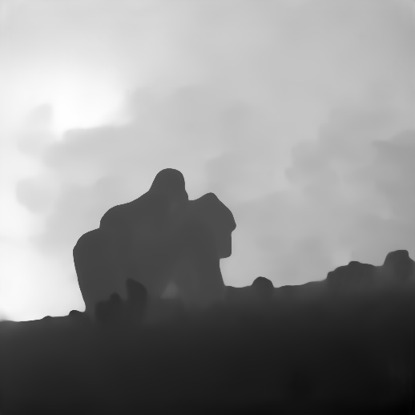
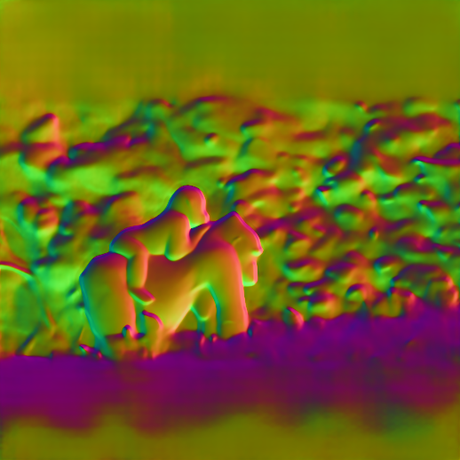

# HunyuanWorld-Mirror — Vulkan inference

Hugging Face: <https://huggingface.co/kylinfires/hunyuanworld-vulkan>

Native **Rust + wgpu/Vulkan** inference for
[HunyuanWorld-Mirror](https://github.com/Tencent-Hunyuan/HunyuanWorld-Mirror),
running on Windows/Linux with an AMD, NVIDIA, or Intel GPU. No CUDA, no PyTorch
at inference time.

One image or a multi-view set / video → depth, normals, camera poses, point
cloud, 3D Gaussian Splatting, an optional TSDF/Poisson mesh, and a built-in 3DGS
render.

```text
GPU        AMD Radeon RX 6900 XT 16 GB
weights    1.26 B params / 5.05 GB f32 / 1544 tensors
input      518 × 518 per view
1 view     11.2 s  (2.5 s weights + 8.6 s GPU forward)
2 views    21.5 s
4 views    49.1 s
```


| depth | normals |
| --- | --- |
|  |  |


## Features

- **Single image** — depth / normals / camera / points / 3DGS
- **Multi-image** — true `S>1` cross-frame attention; per-view outputs plus a fused point cloud / 3DGS / mesh
- **Video** — extract frames with OpenCV, then run the multi-view pipeline
- **Mesh** — Open3D TSDF fusion or Poisson reconstruction (`--mesh tsdf|poisson|both`)
- **3DGS viewer** — built-in software Gaussian-splat renderer and orbit turntable (`--no-render` to skip)
- **PLY output** — standard 17-float 3DGS layout: `f_dc`, opacity, log scale, wxyz quaternion

## Requirements

- Rust 1.80+ (`cargo`)
- Vulkan 1.3/1.4 driver
- Python 3.10+ and `requirements.txt` (weights download, video frames, mesh)
- ~6 GB free disk, <16 GB VRAM

## Quick start

```bash
git clone https://github.com/q760440238/vulkan-world-models.git
cd vulkan-world-models/hunyuanworld
python scripts/download_weights.py

cargo build --release --bin hwm-vk

# single image
./target/release/hwm-vk --image photo.jpg --out out

# multi-view
./target/release/hwm-vk --images path/to/frames --max-views 8 --out out

# video (OpenCV)
./target/release/hwm-vk --video clip.mp4 --fps 1 --max-views 8 --out out

# mesh + turntable
./target/release/hwm-vk --images frames --mesh tsdf --mesh-render --turntable 8 --out out
```

Windows:

```powershell
py -3 scripts\download_weights.py
cargo build --release --bin hwm-vk
.\target\release\hwm-vk.exe --images .\frames --mesh tsdf --mesh-render --out .\out
```

## Options

| Flag | Description |
| --- | --- |
| `--image <path>` | single image; repeatable |
| `--images <dir>` | directory of images (sorted) |
| `--raw <path>` / `--raw-dir <dir>` | preprocessed f32 views |
| `--video <path>` | video input (extracted with OpenCV) |
| `--fps <float>` | video sampling fps (default 1) |
| `--max-views <n>` | cap on views (default 8) |
| `--out <dir>` | output directory |
| `--weights <dir>` | weight directory (default `weights`) |
| `--mode pad\|crop` | image preprocessing (default `pad`) |
| `--no-render` | skip the 3DGS render |
| `--render-size <px>` | 3DGS render size (default 1036) |
| `--turntable <n>` | render an n-frame orbit turntable |
| `--mesh tsdf\|poisson\|both` | build a mesh after inference |
| `--mesh-render` | render the mesh with Open3D |

## How it works

The model is **72 transformer blocks**, not a single ViT:

| Part | Blocks | Details |
| --- | ---: | --- |
| DINOv2 ViT-L/14 backbone | 24 | 1 cls + 4 register + 1369 patch tokens; no RoPE/QK-norm, LN eps 1e-6 |
| VGT frame blocks | 24 | per-frame attention, QK LayerNorm + 2D RoPE, LN eps 1e-5 |
| VGT global blocks | 24 | cross-frame attention, QK LayerNorm + 2D RoPE |
| Camera head | 4 × 4 | 2048-dim, 16 heads, 4 refinement iterations |
| DPT heads | 4 | depth / points / normals / GS, 256-channel refinenet |

Token layout:

```text
patch grid      37 × 37 = 1369
DINOv2          1 cls + 4 reg + 1369 patch = 1374
VGT             1 cam + 4 reg + 1 pose + 1 ray + 1369 patch = 1376
patch_start_idx 7
embed dim       1024
```

All inference math is implemented in WGSL compute shaders:

- tiled f32 GEMM with bias / GELU / ReLU / SiLU / LayerScale / residual / transposed output
- LayerNorm, QKV split, QK-norm, 2D RoPE, tiled QK^T → softmax → PV attention
- direct Conv2d (stride/pad/activation, chunked for dispatch limits), ConvTranspose2d
- bilinear interpolation, DPT UV positional embedding, im2col patch embedding
- camera-head modulation and 4-step iterative refinement
- 3DGS activation, depth→world, 0.002 voxel weighted merge, PLY export

CPU is used only for image decode, small parameter activation, camera matrix
construction, mesh post-process, and PLY/PNG writing.

## Validation

Reference: official PyTorch code + official weights, CPU f32, same inputs.

Single view (518×518):

| Stage | max abs error | cosine |
| --- | ---: | ---: |
| DINOv2 24 blocks | 2.46e-5 | 1.000000 |
| VGT 48 blocks | 6.10e-5 | 1.000000 |
| camera | 1.12e-7 | 1.000000 |
| depth | 3.22e-6 | 0.99999988 |
| pts3d | 8.34e-5 | 1.000000 |
| normals | 6.08e-5 | 1.000000 |
| GS raw | 8.20e-5 | 0.99999994 |

Two-view (`Bright_Room`, 518×518 each):

| Output | max abs error | cosine |
| --- | ---: | ---: |
| camera params | 2.98e-7 | 1.00000000 |
| depth | 5.91e-5 | 1.00000012 |
| pts3d | 1.24e-4 | 1.00000012 |
| normals | 5.00e-4 | 1.00000000 |

## Outputs

```text
out/
  input_0000.png / depth_0000.png / normals_0000.png   # per view
  depth_0000.f32 / pts3d_0000.f32 / normals_0000.f32
  camera_params.f32 / camera_poses.f32 / camera_intrs.f32   # [S,...]
  points.ply
  gaussians.ply          # standard 17-float 3DGS, log scale, wxyz quat
  render_0000.png        # built-in 3DGS render
  turntable.png          # optional
  mesh-tsdf.ply / mesh-poisson.ply, mesh-*.png   # optional
  result.json
```

## Notes

- The built-in renderer uses isotropic Gaussian splats for speed/robustness.
  For production anisotropic gsplat rendering, load `gaussians.ply` in
  gsplat/VkSplat or another standard 3DGS renderer.
- The model outputs point clouds/depth/3DGS, **not a triangle mesh**. Mesh
  export is a separate Open3D post-process (TSDF or Poisson).
- The CLI defaults to at most 8 views; global attention is O(S²) in views.

## License

- Rust/WGSL source: **Apache-2.0** (`LICENSE`).
- HunyuanWorld-Mirror model/weights: **Tencent HunyuanWorld-Mirror Community
  License Agreement**; territory restrictions apply (not EU/UK/South Korea).
- No Tencent weights or Tencent source code are included.
- Not affiliated with or endorsed by Tencent.

See `NOTICE` for details.
